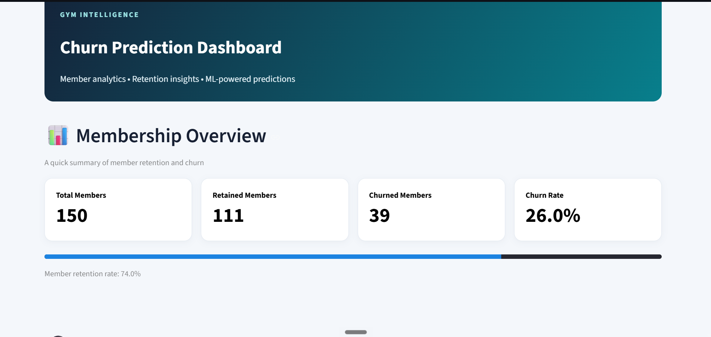
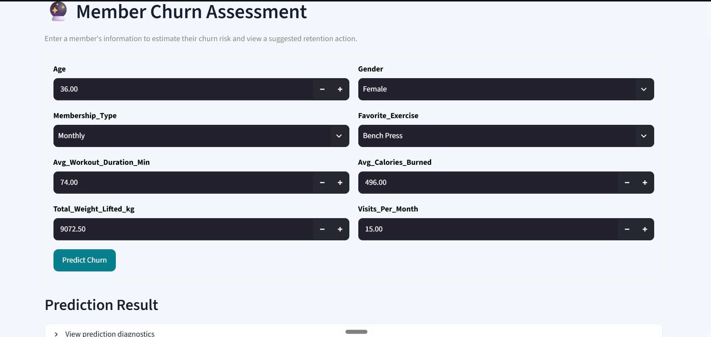
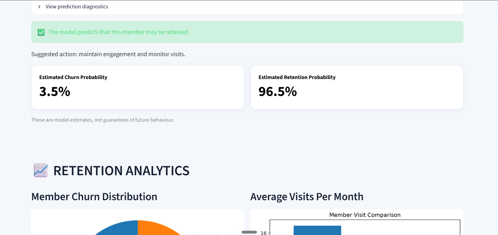
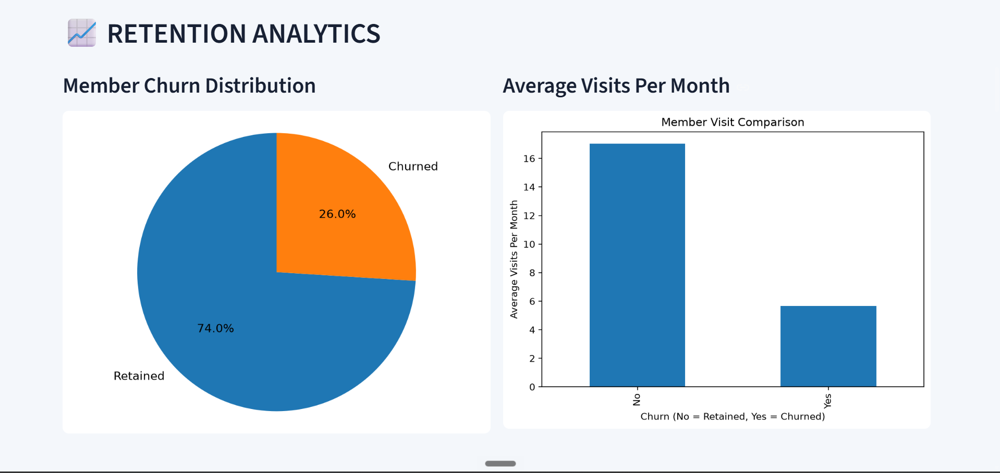

# 🏋️ Gym Churn Prediction Dashboard

An interactive Streamlit dashboard that analyses gym membership data, predicts which members are at risk of leaving (churn), and compares machine learning models.

## Screenshots






## Features

- **Membership overview:** total, retained and churned members, churn rate and retention rate
- **Churn assessment:** enter a member's details and get a churn prediction, probability estimates and a suggested retention action
- **Retention analytics:** churn distribution, visits per month for retained vs churned members, and churn rate by membership type
- **Feature importance:** the top features the Random Forest model relies on
- **Model evaluation:** accuracy, precision, recall and F1-score, a confusion matrix, and a Random Forest vs Logistic Regression comparison on held-out test data
- **Data explorer:** browse the raw records and a numerical summary

## Tech stack

Python · Streamlit · Pandas · Scikit-learn (Random Forest, Logistic Regression) · Matplotlib · Joblib

## Project structure

```
├── app.py                      # Streamlit dashboard
├── train_model.py              # Trains the models and saves churn_pipeline.pkl
├── gym_members_dataset.csv     # Member dataset
├── requirements.txt            # Python dependencies
└── README.md
```

## Getting started

**Tested with:** Python 3.15 on Windows

1. **Clone the repository**
   ```bash
   git clone https://github.com/AKAUSAR03/gym_churn_analysis.git
   cd gym_churn_analysis
   ```

2. **(Recommended) Create a virtual environment**
   ```bash
   python -m venv venv
   venv\Scripts\activate        # Windows
   source venv/bin/activate     # macOS / Linux
   ```

3. **Install dependencies**
   ```bash
   pip install -r requirements.txt
   ```

4. **Train the model** (creates `churn_pipeline.pkl`)
   ```bash
   python train_model.py
   ```

5. **Run the dashboard**
   ```bash
   streamlit run app.py
   ```
   Then open the local URL shown in the terminal (usually http://localhost:8501).

## Dataset

The app expects `gym_members_dataset.csv` in the project folder, with at least a `Churn` column (`Yes`/`No`). The dashboard also uses `Membership_Type` and `Visits_Per_Month` when they are present.

- **Source:** Churn Prediction Gym Members Dataset [https://www.kaggle.com/datasets/hassaan2580/churn-prediction-gym-members-dataset]
- **License / credit:**  CC0: Public Domain

## Model results

| Model               | Accuracy  | Precision | Recall | F1-score |
|---------------------|-----------|-----------|--------|----------|
| Random Forest       | 93.33%    | 100.00%   | 75.00% | 85.71%   |
| Logistic Regression | 86.67%    | 83.33%    | 62.50% | 71.43%   |

## Limitations

- Predictions are statistical estimates, not guarantees of future behaviour.
- Feature importance and observed patterns (e.g. visits vs churn) show association, not cause and effect.
- Results depend on the dataset size, quality and the train/test split.

## Possible improvements

- Hyperparameter tuning and cross-validation
- Handling class imbalance
- Deploying the app on Streamlit Community Cloud

## Author

**NAME:ARSHIYA KAUSAR**
[GitHub](https://github.com/AKAUSAR03) 
[LinkedIn](www.linkedin.com/in/arshiya-kausar-75a491335)

**Feedback and suggestions are welcome. Feel free to open an issue.**